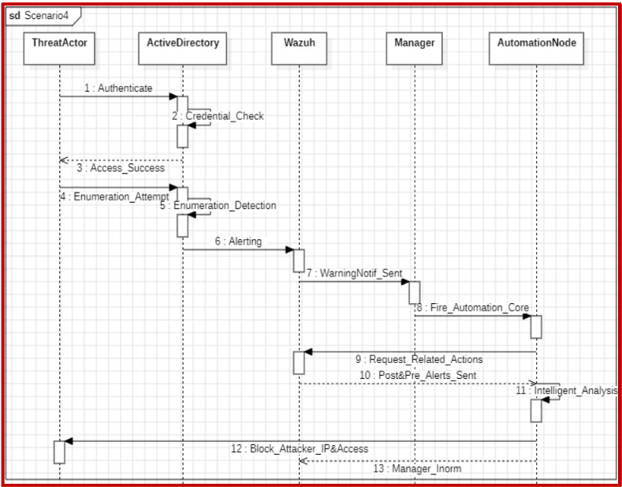
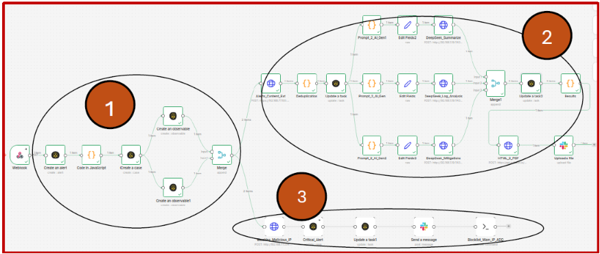

Common Attacks attacks are becoming our main current challenge nowadays notably we have kerberoasting and ticket forgery and more even worse but the main cause of those attacks declenchment is done due to the reconnaissance step.

we tend to <ens>limit</ens> our mitigation proccess to deal only on detecting that **enumeration attempt** and try to consolidate our AD and contain the attacker ip for deeper investigation.

### The workflow is devided into three main steps:

**1 - Attack encadrement:** by creating the case and gathering all the related necessary IOCs we manage to assign tasks to different AI agents for later handling

**2 - Analysis and reporting:** the analysis is dealt by 3 AI agents; the first one deal with analysing directly the captured alert incident the second deal into analysing all the logs that are related to the same IP or username or process in order to come up with conclusions and the final one deals with reporting handling 

**3 - Decision :** Baased on the incident threashold the workflow tries to follow the appropriate mitigations and in general cases it would be instant blocking while enumeration is considered as a threat action from the start

