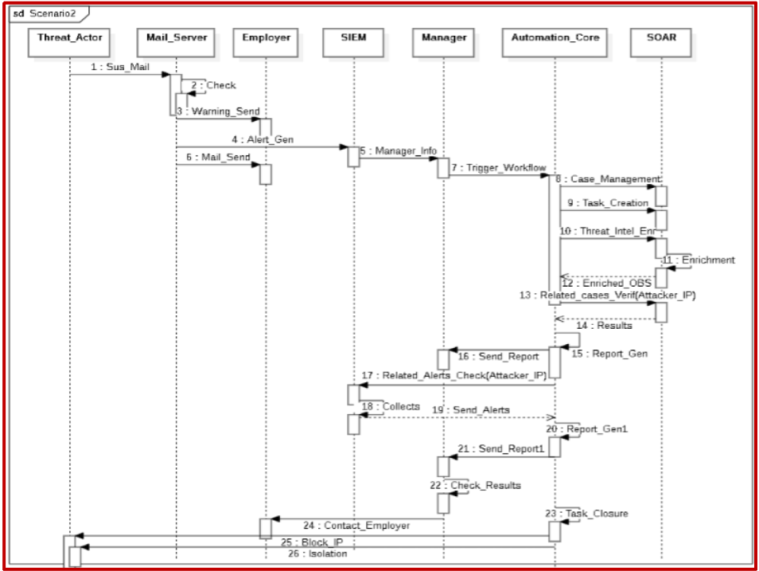
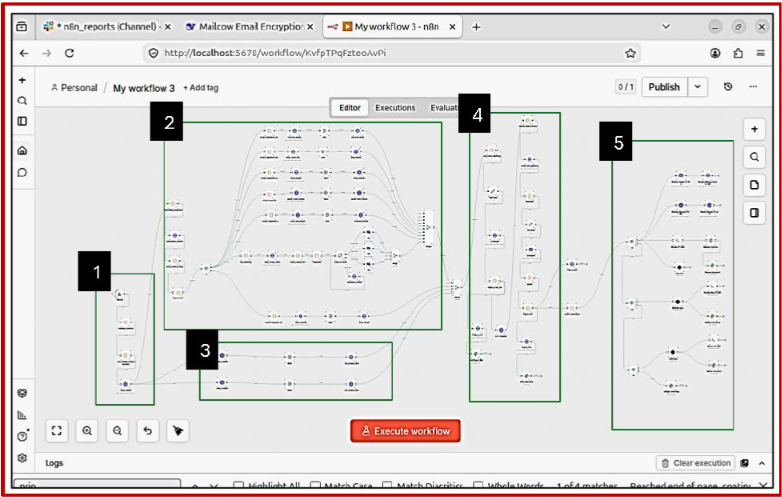

#  Phishing Attack Attempt Mitigation Process

  

The scenario is triggered when one of the critical attack sub-scenarios occurs, specifically critical information snooping and sensitive data leakage attempts.

  

Once an attack alert is detected, the webhook immediately triggers the entire workflow without human intervention. The mitigation process follows these phases:

### Phase 1: Alert Handling Preparation
A case is created automatically, and Indicators of Compromise (IOCs) are extracted from the email captured within the alert body for later enrichment.

### Phase 2: Enrichment
This phase focuses on gathering related events based on the extracted malicious IOCs (IP, process, link, DNS, port, etc.). We utilized the following Cortex analyzers:

| Analyzer | Purpose | Observable Types |
|---|---|---|
| **VirusTotal** | Deep investigation of processes, files, and URLs using multi-engine scanning and crowdsourced YARA/IDS rules. | File, Hash, Domain, IP, URL |
| **AbuseIPDB** | Checking IP reputation and abuse confidence scores. | IP |
| **MISP** | Correlating observables with known threat intelligence events and IOCs from the MISP instance. | IP, Domain, Hash, URL |
| **URLScan.io** | Analyzing suspicious URLs by scanning them in a sandboxed browser environment. | URL, Domain |
| **ail project** | scanning onion related urls. | URL, Domain, IP |

### Phase 3: Task Creation and Assignment
Simultaneously, after gathering all related attack information, tasks are created and assigned to each AI agent based on their designated focus area.

### Phase 4: Analysis and Reporting
The first AI agent analyzes the details of the occurred attack based on the gathered data. The second AI agent analyzes the overall alert flow by reviewing all alerts related to each IOC that were previously collected.

### Phase 5: Decision and Response
Based on the analysis from both agents, a report is generated. The response is determined by the alert criticality:

| Severity | Response Action |
|---|---|
| **LOW** | Recognize the captured alert as a false positive. |
| **MEDIUM** | Contain the sender VM if internal. For external breaches, block the IP from accessing specific areas like the LAN (except the target) and DMZ (except the mailing server) to observe subsequent moves. |
| **HIGH** | Immediately contain the victim VM as a precautionary measure. |
| **CRITICAL** | Immediately block the victim VM and place it under maintenance. |

[← Back to the Automation Welcome Page](https://github.com/yessinebentaher00-lang/PGH-SOC/blob/8bfe17e4f136feb5ce34d7630f47ef9797bf5d8b/Automation/Readme.md)
