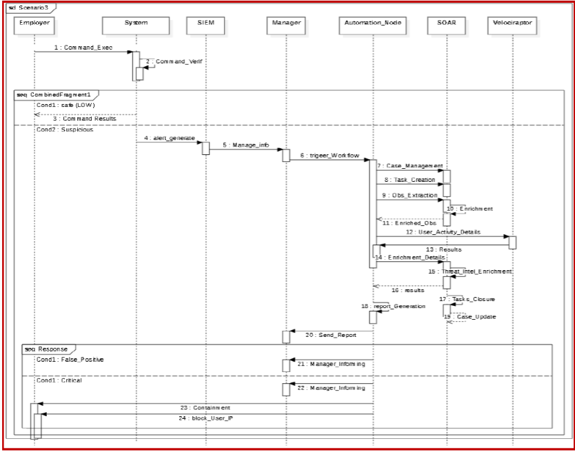
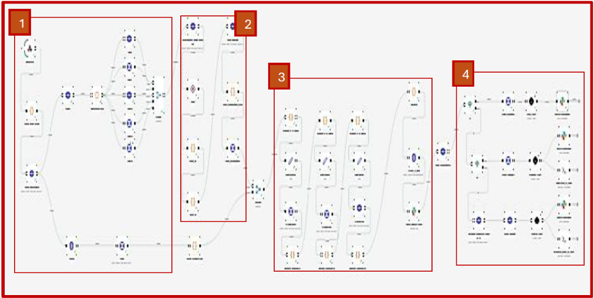
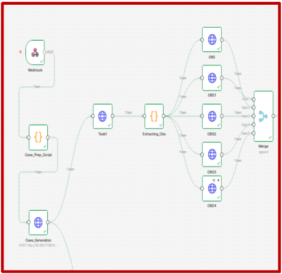
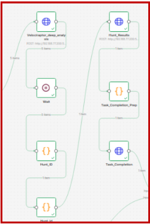
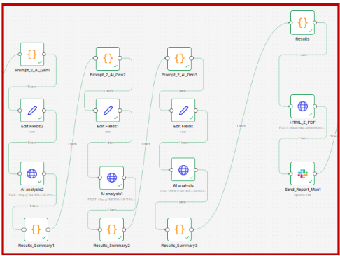
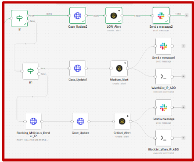

# Privelege escalation and malicious command execution

this scenario is built for all the problems that might be derived from command malicious insertion or execution. 

We have prepared a mitigation workflow that similarely to the phishing scenario must be used automatically after the detection of an alert.

the workflow is composed of 4 main phases:

* 1- Alert Case preparation :

this parts deals with process details extraction, Casse preparation, tasks creation and assignment.

! different methodologie was ued in there for tasks creation; unlike the previous one. Four main tasks were created (Enrichment, Alert basic analysis, related alerts analysis and reporting)

* 2- Enrichment phase:

Unlike the previous phishing attack, this one is done thanks the velociraptor integration **(while cortex can't handle only the IOCs enrichment not the processes)**.

* 3- Analysis phase:

  

the analysis core starts with analysing superficially the alert detected and all the process that have been executed details in order to come up with a conclusion. Next another AI agent will move on analysing all the ip related alerts to check his criticality state and by the end a report is generated as a dedcustion. 

* 4- Response phase:

Same as the phishing response phasee.(copy-paste :p)

